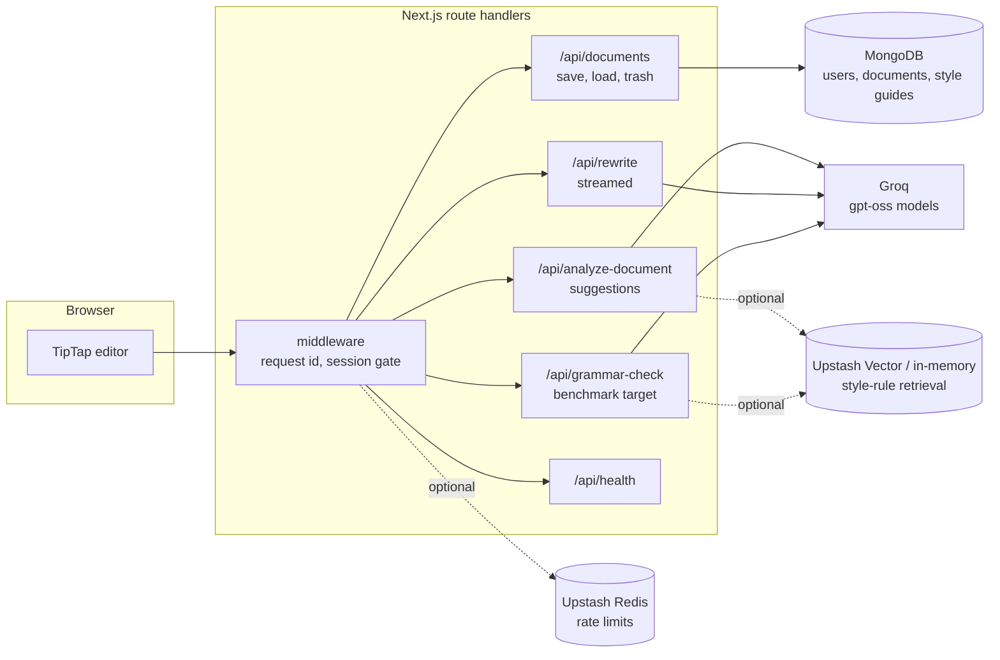

# Grammar Master (writ.ai)

An AI-assisted writing workspace: a rich-text editor with inline grammar, spelling and style suggestions, one-click rewrites, and a per-user style guide. Built with Next.js, MongoDB and Groq (`openai/gpt-oss` models), with a reproducible grammar-correction benchmark (CoNLL-2014, GLEU and ERRANT F0.5).

> Status: the backend is hardened (auth on every route, versioned autosave API, structured logs, CI). The frontend is being rebuilt; some screens are still from the first version. See [Known limits](#known-limits).

## Contents

- [Features](#features)
- [Architecture](#architecture)
- [Evaluation](#evaluation)
- [Getting started](#getting-started)
- [Environment variables](#environment-variables)
- [Scripts and tests](#scripts-and-tests)
- [Observability](#observability)
- [Deployment](#deployment)
- [Known limits](#known-limits)

## Features

- **Editor**: TipTap (ProseMirror) with headings, lists and quotes; suggestions are decorations that stay attached to their words while you type; accepting one is a single undoable step.
- **Autosave with versions**: every save carries the version it was based on; a stale tab gets HTTP 409 instead of silently overwriting newer text.
- **Suggestions**: deterministic rules plus an LLM pass over the document (`/api/analyze-document`).
- **Rewrites**: select text and rewrite it, streamed (`/api/rewrite`).
- **Style guide**: upload brand terminology rules ("Use 'eBPF', never 'Ebpf'") and have them enforced.
- **Documents**: create, upload (`.docx`, `.txt`, `.md`), rename, trash and restore.

## Architecture

Current request flow (what the code does today):



- **Auth**: a signed JWT in an HTTP-only cookie. Protected API routes derive the user from that token, never from an id sent by the client (the remaining demo-user paths are listed under Known limits). The middleware only redirects pages; it is not the security boundary.
- **Documents** live in their own collection (`ownerId`, `status`, `version`, TipTap JSON in `content`, derived `plainText`). Updates are `findOneAndUpdate` on `{_id, ownerId, version}`, so the version check is atomic.
- **Cross-cutting**: structured pino logs with a server-generated request id on every API response (`x-request-id`), optional Sentry, a `/api/health` route that pings the database.

## Evaluation

The harness (`evals/run_eval.py`) scores the live `/api/grammar-check` route on CoNLL-2014 sentences with multi-annotator references: GLEU, ERRANT F0.5, semantic similarity, latency percentiles and cost.

Runs recorded so far (see `evals/reports/`):

| Date | Mode | N | GLEU | F0.5 | Precision | Recall | p50 | p95 |
|---|---|---|---|---|---|---|---|---|
| 2026-09-08 | Live route | 30 | 0.703 | 0.333 | 0.329 | 0.371 | 788 ms | 1095 ms |
| 2026-09-08 | Live route | 150 | 0.765 | 0.516 | 0.518 | 0.567 | 2811 ms | 4012 ms |
| 2026-09-08 | Direct Groq (no app) | 3 | 0.817 | 0.413 | 0.407 | 0.444 | 709 ms | 936 ms |

Read these with care:

- Only the N=150 row is large enough to quote; N=3 and N=30 are smoke tests. The harness now flags any run under 200 sentences.
- Those reports **predate** four fixes: failed requests were scored as a 0 ms "no edit" (the 0.0 ms minimum in the N=30 report), eval requests could be served from the response cache, token counts were word-count estimates, and reports did not record the model or prompt version. All four are fixed; the numbers above have not been re-run.
- A 250-sentence set is included (`evals/datasets/conll2014_eval_250.jsonl`, seed 42, about 15% already-correct control sentences). To regenerate it, place the official CoNLL-2014 test data under `evals/conll14st-test-data/` and run `python evals/scripts/preprocess_m2.py`.

Run it:

```bash
pip install -r evals/requirements.txt && python -m spacy download en_core_web_sm
npm run dev                                           # eval requests are only accepted outside production
python evals/run_eval.py --min-f05 0.25               # exits 1 if the gate fails
```

Each report records the model and prompt version the server actually used, failed requests, and cache hits (any cache hit fails the gate). Once you have a trusted 250-sentence run, keep its JSON and pass `--baseline` so CI fails on a real regression instead of a fixed number. The manual `Eval` workflow in GitHub Actions runs the same command.

## Getting started

Prerequisites: Node.js 20+ (22 recommended), a MongoDB instance (local or Atlas), a [Groq API key](https://console.groq.com).

```bash
git clone https://github.com/daivikawasthi01/Grammar-Master.git
cd Grammar-Master
npm install
cp .env.example .env.local     # then fill it in
npm run dev                    # http://localhost:3000
```

The app refuses to start without `MONGODB_URI`, `JWT_SECRET` and `GROQ_API_KEY`.

## Environment variables

| Variable | Required | Purpose |
|---|---|---|
| `MONGODB_URI` | yes | MongoDB connection string |
| `JWT_SECRET` | yes | Signs session tokens. Use a long random value: `openssl rand -base64 48` |
| `GROQ_API_KEY` | yes | LLM calls |
| `UPSTASH_REDIS_REST_URL`, `UPSTASH_REDIS_REST_TOKEN` | production | Shared rate limiting (without them the limiter is per-process) |
| `UPSTASH_VECTOR_REST_URL`, `UPSTASH_VECTOR_REST_TOKEN` | optional | Style-rule retrieval store (in-memory fallback if unset) |
| `LOG_LEVEL` | optional | `fatal` to `trace`, or `silent`. Default `info` |
| `SENTRY_DSN` | optional | Enables error reporting. Request bodies, cookies and auth headers are never sent |
| `NEXTAUTH_SECRET`, `NEXTAUTH_URL` | legacy | Only while NextAuth is still installed |

## Scripts and tests

| Command | What it does |
|---|---|
| `npm run dev` / `npm run dev:pretty` | Dev server (`dev:pretty` pipes logs through pino-pretty) |
| `npm run typecheck` | `tsc --noEmit` |
| `npm run lint:ci` | Lint; fails if the warning count grows past the current baseline |
| `npm run test:ci` | Unit tests (auth guard, plan limits, style rules, metrics, logger) |
| `npm test` | Everything, including five legacy UI suites that already fail (see Known limits) |
| `npm run build` | Production build (fetches the Inter font from Google at build time) |
| `npm run eval` | Benchmark runner |

CI (`.github/workflows/ci.yml`) runs typecheck, lint, `test:ci` and build on every push and pull request. Dependabot is configured for npm, pip and Actions.

## Observability

- Logs are JSON, one line per event, with `requestId`, `route` and `method`. Passwords, tokens, cookies and authorization headers are redacted at any depth. Use `npm run dev:pretty` locally.
- Every API response carries an `x-request-id`; a user can quote it and you can find every log line for that request. The id is generated by the server; a client-supplied one is ignored.
- `GET /api/health` returns 200 only if MongoDB answers a ping within 2 seconds, otherwise 503. It needs no auth and exposes no internals.
- Set `SENTRY_DSN` to report unhandled server errors.

## Deployment

The app is a single Next.js deployment (intended target: Vercel) plus MongoDB Atlas.

1. Create an Atlas cluster and a database user; allow your host's egress IPs (on Vercel, `0.0.0.0/0` plus a strong password, or Atlas private networking).
2. Create an Upstash Redis database for rate limiting (and Upstash Vector if you want persistent style-rule retrieval).
3. In the host's settings add every variable from the table above. Do not set `NODE_ENV` yourself.
4. Deploy, then check `https://<your-host>/api/health` returns `{"status":"ok","database":"ok"}`.
5. If `JWT_SECRET` was ever unset or weak in a deployed environment, rotate it; existing tokens must be treated as forgeable.

Serverless notes: the response cache, the in-memory rate-limit fallback and the in-memory vector store are per instance and are lost on restart; configure Upstash for anything beyond a demo. The local embedding model (`@xenova/transformers`) downloads from the Hugging Face hub on first use, so the first style-guide request after a cold start is slow.

## Known limits

- **Next.js 15.0.7 is below the fix for CVE-2025-29927** (middleware authorization bypass, fixed in 15.2.3). Every API route re-checks the session itself, which limits the impact, but upgrade before exposing this publicly.
- Two auth systems are still installed (custom JWT and an unused NextAuth); sessions cannot be revoked before the 7-day token expires.
- Some routes still contain a demo-user path (`demo123`), and `GET /api/style-guide` returns five fixed demo rules to anonymous callers.
- Quota counting is read-then-increment, so two simultaneous requests can both pass; `/api/analyze-document` sends the whole document on every check.
- The `tone` and `readability` numbers in the inspector are heuristics, not measurements.
- The editor page still lives at `/account/docs/:id/:userId` and loads through a legacy route; the frontend rebuild replaces it.
- Five UI test suites (`src/app/__tests__` Home, Login, Register, AccountSideBar, AccountNewDoc) already fail on the original code (the router is not mocked) and are excluded from `test:ci` until those screens are rebuilt.
- There is no end-to-end test yet, and the route handlers are not tested against a real database.

## License

MIT
