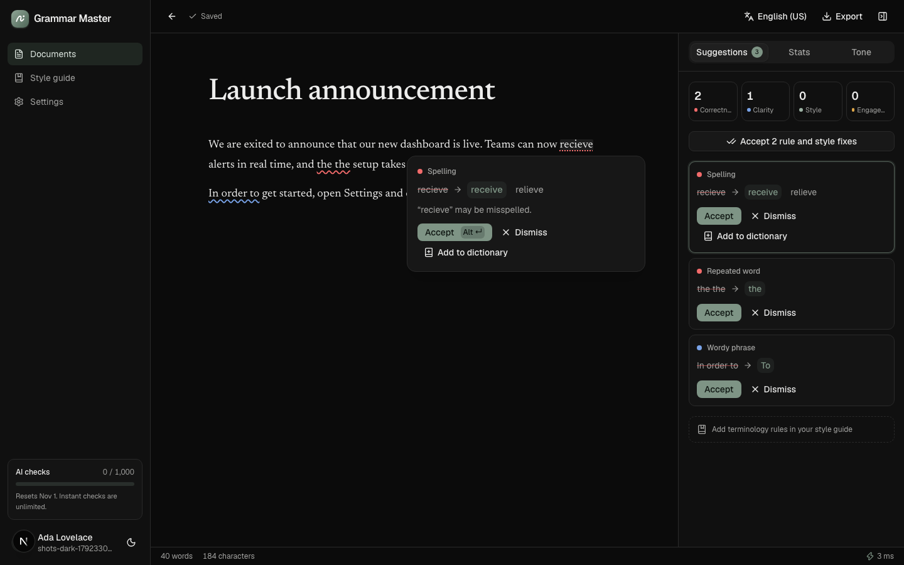
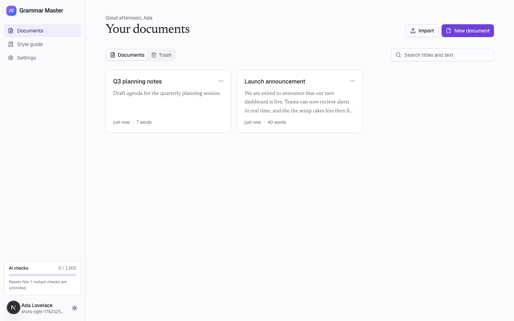
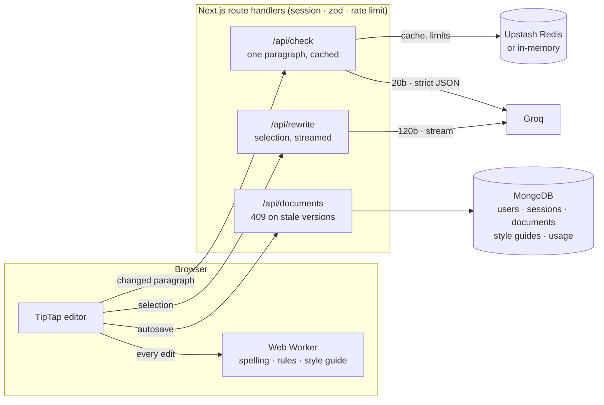

# Grammar Master

A writing workspace that underlines mistakes as you type, enforces your team's terminology, and rewrites a selection when you ask, without touching the rest.

Built with Next.js 16, React 19, MongoDB and Groq (`gpt-oss` models), with a reproducible grammar-correction benchmark (CoNLL-2014, GLEU and ERRANT F0.5).


| Editor | Documents |
|---|---|
|  |  |

## Contents

- [Features](#features)
- [Architecture](#architecture)
- [Getting started](#getting-started)
- [Environment variables](#environment-variables)
- [Scripts and tests](#scripts-and-tests)
- [Upgrading an existing database](#upgrading-an-existing-database)
- [Evaluation](#evaluation)
- [Deployment](#deployment)
- [Observability](#observability)
- [Security notes](#security-notes)
- [Known limits](#known-limits)
- [Credits](#credits)

## Features

- **Instant checks in the browser.** Spelling (a Hunspell dictionary via `nspell`), phrasing rules and your style guide run in a Web Worker on every pause. Results arrive in milliseconds and never leave the device.
- **Paragraph-level AI checks.** When a paragraph settles, only that paragraph is sent to `/api/check`. A fast model returns minimal edits in a strict JSON schema, and each edit is verified against the text before it is underlined. Typing again cancels the request, and stale answers are ignored.
- **Underlines that follow your text.** Suggestions are ProseMirror decorations, mapped through every edit. Accepting one is a single undo step; dismissals stick.
- **Streamed rewrites.** Select text, pick *Improve*, *Concise*, *Formal*, *Simplify* and more; the preview streams in and replaces only the selection.
- **Style guide.** Paste or upload your guide ("Use 'eBPF', never 'Ebpf'", "e-mail → email"). Lines are parsed once into structured rules, previewed for review, matched instantly, and only matching rules are given to the AI.
- **Autosave that never loses work.** Every save carries the version it was based on; a stale tab gets a conflict notice (load latest / keep mine) instead of silently overwriting newer text. Save state is always visible: saving, saved, offline (retries), conflict.
- **Documents.** Create, import `.docx` / `.txt` / `.md` (5 MB cap), rename, search, trash with undo, restore, and permanent delete. Trash is purged after 30 days.
- **Honest stats.** Real Flesch reading ease and Flesch–Kincaid grade, issues per 100 words. Tone is an on-demand AI reading, labelled as an estimate.
- **Export** to a real Word file (`.docx`, headings and lists preserved), Markdown, plain text, or print / PDF.
- **Accessible.** Keyboard shortcuts (Alt+Enter accept, Alt+Backspace dismiss, Alt+↓/↑ next/previous), polite `aria-live` announcements, visible focus, pinch zoom allowed, light and dark themes, reduced-motion support.

## Architecture



| Layer | Choice |
|---|---|
| Framework | Next.js 16 (App Router, `proxy.ts`), React 19, TypeScript |
| UI | Tailwind CSS 4, shadcn/ui (Radix), Motion, lucide-react, a WebGL2 particle hero |
| Editor | TipTap 3 with a custom suggestions extension |
| Server state | TanStack Query 5 (refetch on focus, optimistic trash/restore with rollback) |
| Forms | react-hook-form with the same zod schemas the API validates with |
| Data | MongoDB with Mongoose 9: `users`, `sessions`, `documents`, `styleguides`, `usages` |
| AI | Groq through a small `LLMClient` interface; versioned prompts in one module |
| Tests | Vitest (unit + route tests on an in-memory MongoDB), Playwright end-to-end |

Code layout:

```
src/
  app/                 routes: (marketing), (auth), app/, api/
  components/          ui/ (shadcn), editor/, app/, marketing/
  server/              db, models, auth (sessions, passwords), services, http wrapper,
                       rate limits, quota, cache, ai (LLM client, prompts)
  shared/              zod schemas and the checks shared by browser and server
  workers/             the instant-checks Web Worker
scripts/               one-off data migration
e2e/                   Playwright tests
evals/                 benchmark harness
```

Key decisions:

- **Auth** is a signed, HTTP-only cookie that names a server-side session. The proxy checks the signature for redirects; every API route and the `/app` layout check the session row in the database, so logout and password changes revoke access immediately. Identity always comes from the session, never from an id in the request.
- **Every route** goes through one wrapper (`src/server/http.ts`): session, rate limit, zod validation, and typed errors (`{ error: { code, message, requestId } }` with 401, 404, 409, 413, 415, 422, 429, 502, 503).
- **Quota** is reserved with one atomic conditional upsert before an AI call and refunded if the call fails, so parallel requests cannot overspend and outages do not burn quota.

## Getting started

Prerequisites: Node.js 20.9+ (22 recommended), MongoDB (local or Atlas), a [Groq API key](https://console.groq.com).

```bash
git clone https://github.com/daivikawasthi01/Grammar-Master.git
```

```bash
cd Grammar-Master && npm install
```

```bash
cp .env.example .env.local
```

Fill in `.env.local` (see below), then:

```bash
npm run dev
```

Open http://localhost:3000. The server refuses to start if `MONGODB_URI`, `JWT_SECRET` (32+ characters) or `GROQ_API_KEY` is missing.

## Environment variables

| Variable | Required | Purpose |
|---|---|---|
| `MONGODB_URI` | yes | MongoDB connection string |
| `JWT_SECRET` | yes | Signs session cookies. At least 32 characters: `openssl rand -base64 48` |
| `GROQ_API_KEY` | yes | AI checks, rewrites and tone |
| `UPSTASH_REDIS_REST_URL`, `UPSTASH_REDIS_REST_TOKEN` | production | Shared rate limits and AI response cache. Without them both are per process |
| `MONTHLY_AI_LIMIT` | optional | AI calls per user per month (default 1000) |
| `LOG_LEVEL` | optional | `fatal` … `trace`, or `silent` (default `info`) |
| `SENTRY_DSN` | optional | Error reporting. No bodies, cookies, headers or user info are sent |

Blank values count as unset.

## Scripts and tests

| Command | What it does |
|---|---|
| `npm run dev` / `npm run dev:pretty` | Dev server (`dev:pretty` pipes logs through pino-pretty) |
| `npm run typecheck` | `tsc --noEmit` |
| `npm run lint` / `npm run lint:ci` | ESLint (CI allows zero warnings) |
| `npm test` / `npm run test:ci` | Vitest: shared checks, style-rule matcher, readability, migration, and route tests against an in-memory MongoDB (auth sweep over every protected route, ownership, version conflicts, uploads, quota, AI failure handling) |
| `npm run test:e2e` | Playwright critical path: register, write, instant suggestion, accept, undo, reload; two-tab conflict; trash/restore; signed-out access. Needs a MongoDB (`E2E_MONGODB_URI`, default `mongodb://127.0.0.1:27017/gm_e2e`); no Groq key needed |
| `npm run build` | Production build |
| `npm run migrate:documents` | Data migration (see below) |
| `npm run eval` | Benchmark runner |

Regenerate the README screenshots with `E2E_SCREENSHOTS=1 npm run test:e2e -- screenshots`.

CI (`.github/workflows/ci.yml`) runs typecheck, lint, Vitest and build, and a separate Playwright job against a MongoDB service container. Dependabot is configured for npm, pip and Actions.

## Upgrading an existing database

Older versions stored documents inside each user record (`users.documents[]`, `users.trashs[]`) and the password hash in `users.password`. **Until the migration runs, existing users cannot sign in and their documents are not visible.**

```bash
MONGODB_URI="<your connection string>" npm run migrate:documents
```

That is a dry run: it reports what would change and writes nothing. To apply it:

```bash
MONGODB_URI="<your connection string>" npm run migrate:documents -- --apply
```

With `--apply` it first writes a JSON backup of every affected user to `backups/`, then copies each embedded document into the `documents` collection under its original id, renames `password` to `passwordHash`, and removes the embedded arrays only once every document has been copied. Re-running is a no-op.

## Evaluation

The harness (`evals/run_eval.py`) scores the live `/api/check` route on CoNLL-2014 sentences with multiple human references: GLEU, ERRANT F0.5, semantic similarity, latency percentiles and cost. The route returns minimal edits, which the harness applies to each sentence.

Recorded runs (see `evals/reports/`):

| Date | Mode | N | GLEU | F0.5 | Precision | Recall | p50 | p95 |
|---|---|---|---|---|---|---|---|---|
| 2026-09-08 | Live route | 150 | 0.765 | 0.516 | 0.518 | 0.567 | 2811 ms | 4012 ms |
| 2026-09-08 | Live route | 30 | 0.703 | 0.333 | 0.329 | 0.371 | 788 ms | 1095 ms |

These runs measured the **previous** whole-sentence prompt and model routing; the current minimal-edit check has not been benchmarked yet. Only the 150-sentence run is large enough to quote. A pinned 250-sentence set with ~15% clean control sentences is included.

Run it (dev server running, eval requests are only honoured outside production and skip the cache and quota):

```bash
pip install -r evals/requirements.txt && python -m spacy download en_core_web_sm
```

```bash
EVAL_AUTH_COOKIE="gm_session=<cookie from a signed-in browser>" python evals/run_eval.py --min-f05 0.25
```

Each report records the model and prompt version the server used, failed requests and cache hits. The manual **Eval** workflow in GitHub Actions does the same against a fresh database.

## Deployment

A single Next.js deployment (for example on Vercel) plus MongoDB Atlas and Upstash Redis.

1. Create an Atlas cluster and database user; allow your host's egress (on Vercel: `0.0.0.0/0` with a strong password, or Atlas private networking).
2. Create an Upstash Redis database for rate limits and the AI cache.
3. Set every variable from the table above in the host. Do not set `NODE_ENV` yourself.
4. If you have data from an older version, run the [migration](#upgrading-an-existing-database) (dry run first).
5. Deploy, then check `https://<your-host>/api/health` returns `{"status":"ok","database":"ok"}`.
6. If `JWT_SECRET` was ever unset or weak in a deployed environment, rotate it.

## Observability

- JSON logs (pino), one line per event, with `requestId`, route and user id. Passwords, tokens, cookies and auth headers are redacted at any depth. `npm run dev:pretty` for readable local logs.
- Every API response carries `x-request-id`; error bodies and the UI include it for 5xx errors, so a user can quote it.
- `GET /api/health` returns 200 only if MongoDB answers a ping within 2 seconds, otherwise 503.
- `SENTRY_DSN` enables error reporting with data collection switched off.

## Security notes

- Sessions are revocable (logout, password change ends other sessions); cookies are HTTP-only, `SameSite=Lax`, `Secure` in production.
- Login is rate-limited per IP and per account, takes the same time for unknown emails and wrong passwords, and returns the same error for both.
- Password, email and account-deletion changes require the current password.
- Documents are queried by owner: another user's document id answers 404.
- Request bodies are size-capped and validated; AI prompts keep instructions in the system message and user text in the user message, with fixed rewrite actions (no free-form prompts).
- If Redis is unreachable, rate limiting and caching fail open (logged as warnings) rather than locking everyone out.

## Known limits

- The current check prompt has not been benchmarked (see Evaluation).
- The spelling dictionary is US English for every dialect; British spellings may be flagged.
- The landing-page sculpture images load from `cdn.21st.dev`; self-host them for production if you prefer no third-party requests.
- One plan only (a monthly AI allowance); there is no billing.
- Without Upstash, rate limits and the AI cache are per server instance.
- `npm audit` reports advisories in development-only tooling (the ESLint plugin's glob matcher) and in mammoth's CLI argument parser; none is reachable from request handling.

## Credits

- Landing hero: liquid particle sculpture by [guglielmogiannattasio.it](https://guglielmogiannattasio.it).
- English dictionary: [`dictionary-en`](https://github.com/wooorm/dictionaries) (see `public/dictionaries/LICENSE-en.txt`).
- UI components: [shadcn/ui](https://ui.shadcn.com).

## License

MIT
